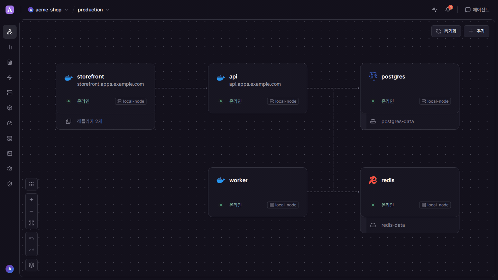
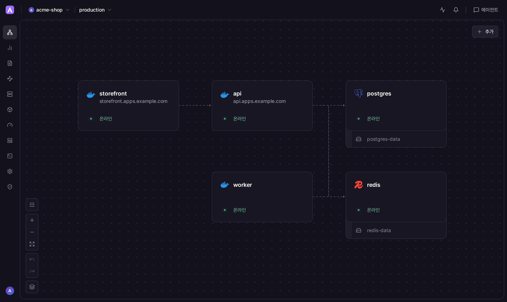
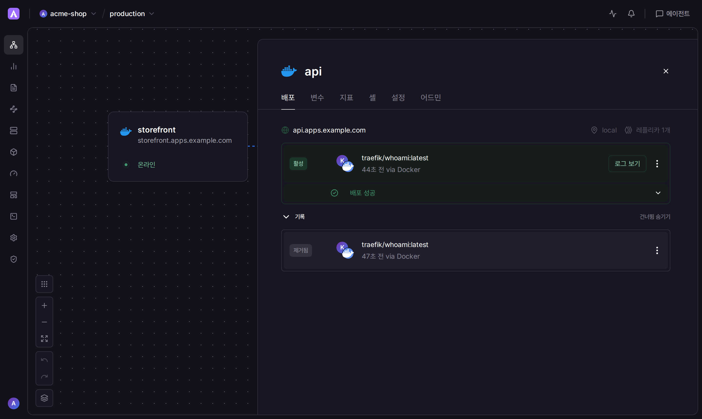
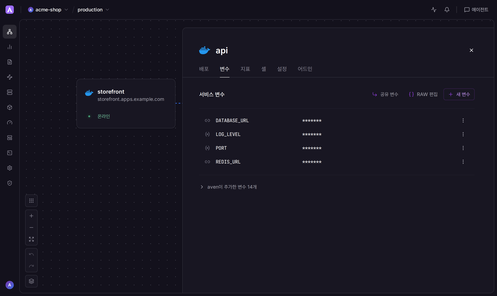
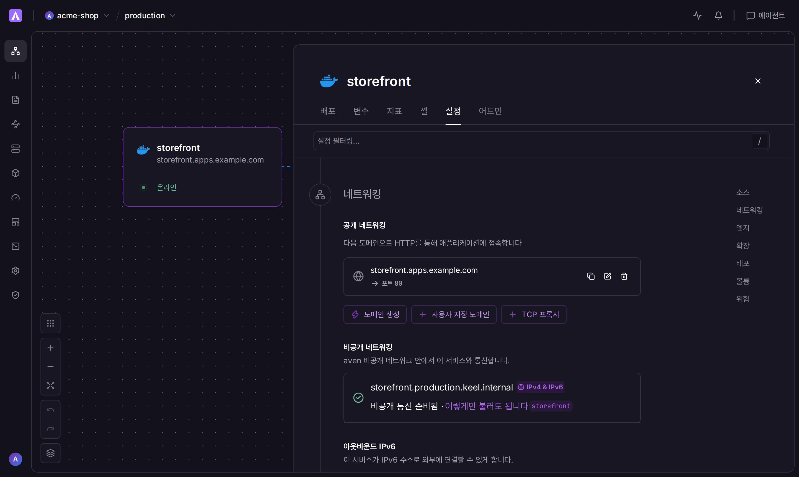
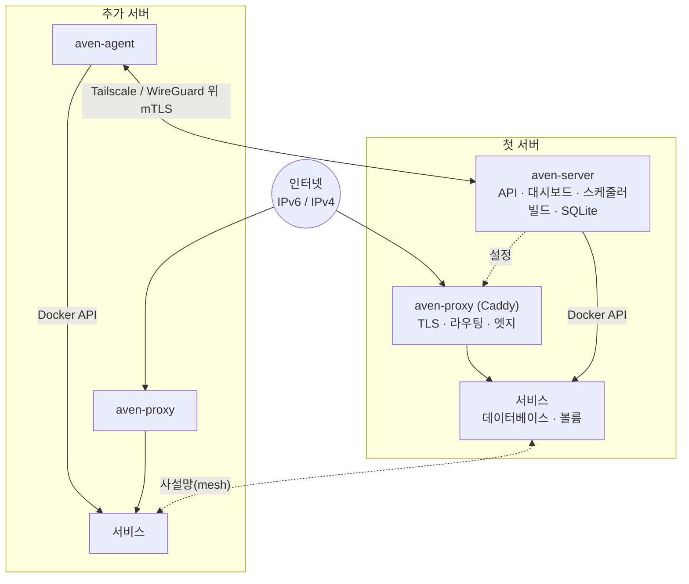

# Aven: 셀프호스팅 Railway 스타일 PaaS

[English](README.md) | 한국어

**Railway처럼 쓰는데, 내 서버에서, 사용량 요금 없이.**

[](https://github.com/turin-dev/aven/releases)
[](https://github.com/turin-dev/aven/actions/workflows/ci.yml)
[](LICENSE)

[빠른 시작](#빠른-시작) · [비교](#비교) · [기능 안정성](#기능-안정성) · [주요 기능](#주요-기능) · [구조](#구조) · [문서](#문서) · [자주 묻는 질문](#자주-묻는-질문)

Railway, Coolify, Dokploy는 각 권리자의 상표입니다. Aven은 그 주체들과 관련이 없습니다. 이 이름들은 Aven이 무엇과 비슷한지, 비교하면 어떤지만 설명하려고 씁니다.

> [!IMPORTANT]
> Aven은 독립 프로젝트이고, 이 저장소에는 Railway 소스 코드가 없습니다. 캔버스와 서비스 작업 흐름은 Railway를 따르며, 프로젝트를 옮겨 오기 쉽도록 `railway.json` / `railway.toml`을 읽고 Railway 형태의 GraphQL 질의에 답합니다. [Railway와의 관계](#railway와의-관계)를 보세요.

- 내 서버에서 돌립니다. `aven-server` 프로세스 하나가 Docker 옆에서 동작하고, 머신을 더 붙일 때는 `aven-agent`를 씁니다. 운영할 Kubernetes 클러스터는 없습니다.
- 이 저장소의 소프트웨어에는 사용량 요금도, 유료로 잠긴 기능도 없습니다. 내는 돈은 직접 돌리는 머신 비용입니다.
- 라이선스는 [AGPL-3.0-only](LICENSE)입니다. SAML SSO와 패스키는 그 코어에 들어 있습니다.
- 캔버스, `railway.json`, Railway 형태의 GraphQL API는 Railway 스타일의 작업 흐름을 따릅니다.
- GitHub push 배포, pull request 미리보기 환경, 클릭 한 번의 Postgres, MySQL, Redis, MongoDB가 포함됩니다.



> [!NOTE]
> Aven은 아직 젊고 빠르게 바뀝니다. 릴리스 사이에 인터페이스와 설정이 바뀔 수 있으니, 업그레이드 전에 릴리스 노트를 읽고 데이터 디렉터리를 백업하세요. 아래 [기능 안정성](#기능-안정성)은 이 트리의 테스트가 어디까지 덮는지를 적습니다. 지원 약속이 아닙니다.

## 빠른 시작

아래 설치 명령은 [`install-server.sh`](install-server.sh)에 있는 명령입니다. 요구 사항과 첫 실행의 나머지 단계는 [셀프 호스팅 가이드](docs/self-hosting.ko.md)에 있습니다.

필요한 것:

- systemd와 Docker가 있고 80·443 포트가 비어 있는 Linux 서버(amd64 또는 arm64)
- 대시보드용 DNS 이름(예: `aven.example.com`)과, 생성 도메인을 쓰려면 와일드카드(`*.apps.example.com`)
- 여러 서버를 쓸 경우 Tailscale이나 WireGuard 같은 사설망으로 서로 닿는 추가 서버(선택)

```sh
curl -fsSL https://raw.githubusercontent.com/turin-dev/aven/main/install-server.sh | sudo sh
```

터미널에서 실행하면 대시보드 주소, 서비스용 기본 도메인, Let's Encrypt 이메일, 관리자 비밀번호를 차례로 묻고 요약을 보여 준 뒤 확인을 받고 설치합니다. 스크립트는 릴리스 체크섬을 확인하고 `aven-server`, CLI, Railpack을 설치합니다. 설정을 `/etc/aven/aven.env`에 쓰고(관리자 비밀번호를 정하지 않으면 새로 만듭니다), 서비스를 시작한 뒤 로그인 정보와 만들어야 할 DNS 레코드를 알려 줍니다. `aven.example.com`(생성 도메인을 쓰려면 `AVEN_BASE_DOMAIN`과 함께 `*.apps.example.com`도)을 서버로 향하게 하고 로그인한 다음, *어드민 → Owner · 초기 설정*의 체크리스트를 따라가세요.

그다음 프로젝트를 열고 캔버스에서 **추가**를 눌러 첫 서비스를 배포합니다. DNS, 설정, 직접 설치, 백업, 업그레이드, 서버 추가는 [셀프 호스팅 가이드](docs/self-hosting.ko.md)에 있습니다.

## 화면

| 캔버스 | 배포 |
| --- | --- |
|  |  |
| **변수** | **네트워킹** |
|  |  |

## 비교

Aven 칸은 이 저장소에서 가져왔습니다. 다른 제품 칸은 표 아래 공식 페이지에서 가져왔고, 확인 날짜는 2026-10-27입니다. “문서에 없음”은 그 페이지가 기능을 설명하지 않았다는 뜻이며, 기능이 없다는 주장이 아닙니다.

| | Aven | Railway | Coolify | Dokploy |
| --- | --- | --- | --- | --- |
| 셀프호스팅 | 예. Linux 호스트에서 `aven-server`, 추가 호스트에서 `aven-agent`. [^aven] | Free부터 Enterprise까지 호스팅 플랜. Enterprise에는 Railway가 관리하는 전용 호스트가 있습니다. 자기 서버용 설치 프로그램은 문서에 없음. [^r-price] [^r-ent] | 예. 셀프호스팅이 무료 에디션입니다. [^c-price] | 예. Self-Hosted (OSS). [^d-diff] |
| 요금 | 이 저장소에는 사용량 요금도 유료 기능 게이트도 없습니다. 머신 비용은 직접 냅니다. [^aven] | CPU, 메모리, 볼륨을 초 단위로 과금하고 플랜 요금이 붙습니다. Free 플랜은 월 $0에 사용 크레딧 $1입니다. [^r-price] | 셀프호스팅은 무료이고 현재와 이후 기능을 모두 포함합니다. Cloud는 서버 2대까지 월 $5, 그다음 서버마다 월 $3입니다. [^c-price] | Self-Hosted (OSS)는 무료입니다. Cloud는 서버당 월 $4.50부터입니다. Enterprise는 라이선스(문의)입니다. [^d-diff] |
| 라이선스 | AGPL-3.0-only. [^a-lic] | 플랫폼 소스는 공개되지 않았습니다. CLI는 오픈소스입니다. [^r-cli] | Apache-2.0. [^c-lic] | Apache-2.0. `/proprietary` 디렉터리가 있으면 `LICENSE.MD`는 그 부분을 별도의 독점 라이선스로 둡니다. [^d-lic] |
| 무료 구성의 SSO | 예. SAML SSO가 코어에 있습니다. [^a-sso] | Free 플랜에는 없습니다. SSO는 Enterprise와 committed spend에 있습니다. [^r-price] | 셀프호스팅(무료 에디션)은 v4.3.0부터 예. Coolify Cloud는 자체 로그인을 관리합니다. [^c-sso] | 없습니다. SSO는 Enterprise 전용입니다. OSS와 Enterprise가 아닌 Cloud에는 없습니다. [^d-diff] |
| 패스키 | 예. 대시보드 로그인용 WebAuthn 패스키. [^a-pk] | 예. 계정 MFA입니다. MFA 문서에 플랜 제한은 없습니다. [^r-mfa] | Coolify 자체 로그인용은 문서에 없음(2FA와 SSO는 있음). [^c-pk] | 예. 패널 로그인에 있습니다. Cloud 플랜 표에는 Hobby용으로 나오지 않습니다. [^d-pk] |
| 여러 노드 | 예. 추가 서버는 `aven-agent`로 붙입니다. [^a-nodes] | Railway 플랫폼의 수평 replica(플랜 한도)와 지역. 자기 서버를 붙이는 기능은 문서에 없음. [^r-nodes] | 예. 셀프호스팅은 서버를 무제한으로 연결할 수 있습니다. [^c-price] | 예. OSS 에디션의 멀티 서버 / 원격 서버. [^d-diff] |
| 미리보기 환경 | 예. pull request 환경. [^a-prev] | 예. PR이 열리면 만들고, 머지하거나 닫으면 지우는 PR 환경. [^r-prev] | 예. pull request와 merge request 미리보기. [^c-prev] | 예. GitHub pull request 미리보기. 기본값은 꺼져 있습니다. [^d-prev] |
| 관리형 데이터베이스 | 내 서버에서 클릭 한 번으로 Postgres, MySQL, Redis, MongoDB, S3 호환 버킷. [^a-db] | Postgres, MySQL, Redis, MongoDB 템플릿. Railway가 각각 프로비저닝합니다. HA는 켜서 전환합니다. [^r-db] | 내 서버에서 클릭 한 번으로 Postgres, MySQL, MariaDB, MongoDB, Redis, Dragonfly, KeyDB, ClickHouse. SQLite는 experimental. [^c-db] | 내 서버에서 MySQL, PostgreSQL, MongoDB, Redis, MariaDB. [^d-feat] |
| PITR / 백업 | 백업 저장소로 보내는 Postgres WAL·MySQL binlog PITR, 논리 백업, Aven 자체 SQLite 복사본. [^a-pitr] | 볼륨 백업과, 직접 켜는 Postgres·MySQL PITR. [^r-pitr] | 예약 덤프(Postgres는 `pg_dump` / `pg_dumpall`)와 선택적 S3. Postgres 가이드는 PITR을 따로 구성하는 연속 WAL 아카이빙이라고 합니다. [^c-pitr] | 수동·예약 데이터베이스 백업. PITR은 문서에 없음. [^d-feat] |
| Git push 배포 | GitHub push webhook. 이 트리에는 git receive-pack 서버가 없습니다. [^a-git] | 연결된 브랜치에 push하면 GitHub autodeploy. [^r-git] | GitHub App, GitLab, 또는 저장소 webhook으로 push 배포. [^c-git] | push하면 GitHub autodeploy. GitHub, GitLab, Bitbucket, Gitea용 webhook. [^d-git] |
| Dockerfile / buildpack / Nixpacks | Dockerfile과 Railpack. `nixpacksPlan` 같은 모르는 `railway.json` 키는 무시합니다. Dokploy의 nixpacks 빌드는 Railpack으로 가져옵니다. [^a-build] | Railpack과 Dockerfile. Heroku·Paketo buildpack은 2025년에 종료됐고, 빌드 문서에는 Nixpacks가 더 이상 나오지 않습니다. [^r-build] [^r-bp] | Nixpacks, Dockerfile, Docker Compose, static. 문서의 빌드 방식에 buildpack은 없습니다. [^c-build] | Nixpacks(기본값), Railpack, Dockerfile, Heroku buildpack, Paketo buildpack, static. [^d-build] |
| 웹 UI | 예. 내장 대시보드, 영어와 한국어. [^aven] | 예. 프로젝트 캔버스와 서비스 설정. [^r-ui] | 예. 대시보드. [^c-price] | 예. 대시보드. [^d-diff] |
| CLI | 예. `aven`. [^a-cli] | 예. Railway CLI. 오픈소스로 문서화되어 있습니다. [^r-cli] | 예. `coolify`. [^c-cli] | 예. `@dokploy/cli`. [^d-cli] |

[^aven]: 이 저장소: [README.md](README.md), [docs/self-hosting.md](docs/self-hosting.md), [install-server.sh](install-server.sh). Go 소스와 문서에서 과금, 가격, 라이선스 키 게이트는 찾지 못했습니다.
[^a-lic]: [LICENSE](LICENSE)와 [THIRD_PARTY_NOTICES.md](THIRD_PARTY_NOTICES.md) (AGPL-3.0-only).
[^a-sso]: `internal/api/api.go`의 SAML 라우트, [docs/permissions.md](docs/permissions.md), [docs/cli.md](docs/cli.md), `internal/api/saml_test.go`.
[^a-pk]: `internal/api/auth.go`, `internal/api/mfa_test.go`, `internal/store/mfa_test.go`.
[^a-nodes]: [docs/self-hosting.md](docs/self-hosting.md) (“Adding servers”), `internal/store/nodes_test.go`, `internal/deploy/mesh_test.go`.
[^a-prev]: `internal/api/github_preview_test.go`, `internal/store/preview_test.go`.
[^a-db]: `internal/catalog/catalog.go`의 Postgres, MySQL, Redis, MongoDB와 [docs/cli.md](docs/cli.md)의 버킷 서비스.
[^a-pitr]: [docs/cli.md](docs/cli.md)의 `aven pitr`(Postgres WAL, MySQL binlog), `internal/api/dbpitr_test.go`, `internal/agent/dbbackup_test.go`, [docs/self-hosting.md](docs/self-hosting.md)의 서버 데이터베이스 백업.
[^a-git]: [docs/self-hosting.md](docs/self-hosting.md)의 GitHub webhook 설정. Go 트리에서 git receive-pack 서버는 보이지 않았습니다.
[^a-build]: [docs/self-hosting.md](docs/self-hosting.md), `internal/config/config.go`(`nixpacksPlan`을 포함한 모르는 키는 무시), `internal/dokploy/translate.go`(nixpacks 빌드는 Railpack으로 바뀜).
[^a-cli]: [docs/cli.md](docs/cli.md), `cmd/aven`.

[^r-price]: [railway.com/pricing](https://railway.com/pricing)와 [railway.com/enterprise](https://railway.com/enterprise), 2026-10-27에 확인. 요금 페이지는 Free부터 Enterprise, 초 단위 사용 요금, Enterprise와 committed spend의 SSO를 적습니다.
[^r-cli]: [docs.railway.com/cli](https://docs.railway.com/cli) (“The Railway CLI is open source”), 2026-10-27에 확인.
[^r-mfa]: [docs.railway.com/access/multi-factor-authentication](https://docs.railway.com/access/multi-factor-authentication), 2026-10-27에 확인. 패스키를 설명하고 플랜은 적지 않습니다.
[^r-nodes]: replica 한도는 [railway.com/pricing](https://railway.com/pricing). 지역은 [docs.railway.com/deployments](https://docs.railway.com/deployments) (“Deploy to specific geographic regions”). 두 페이지 모두 자기 서버를 붙이는 방법은 설명하지 않습니다.
[^r-prev]: [docs.railway.com/guides/preview-deployments-with-pr-environments](https://docs.railway.com/guides/preview-deployments-with-pr-environments), 2026-10-27에 확인.
[^r-db]: [Postgres](https://docs.railway.com/databases/postgresql), [MySQL](https://docs.railway.com/databases/mysql), [Redis](https://docs.railway.com/databases/redis), [MongoDB](https://docs.railway.com/databases/mongodb), 2026-10-27에 확인.
[^r-pitr]: [docs.railway.com/volumes/point-in-time-recovery](https://docs.railway.com/volumes/point-in-time-recovery) (Postgres와 MySQL)와 위 Postgres·MySQL 페이지의 백업 절, 2026-10-27에 확인.
[^r-git]: [docs.railway.com/deployments/github-autodeploys](https://docs.railway.com/deployments/github-autodeploys), 2026-10-27에 확인.
[^r-bp]: [Heroku Buildpacks & Paketo deprecation notice](https://station.railway.com/feedback/important-heroku-buildpacks-paketo-de-8e60f54d), Railway 직원이 2025-01-13에 게시, 2026-10-27에 확인. Railway는 2025-02-21에 두 빌더를 종료했습니다.
[^r-ent]: [docs.railway.com/maturity/enterprise](https://docs.railway.com/maturity/enterprise), 2026-10-27에 확인 (“Your workloads run on dedicated Railway hosts for complete resource isolation”).
[^r-build]: [docs.railway.com/builds](https://docs.railway.com/builds), 2026-10-27에 확인. Railpack과 Dockerfile을 설명합니다. Nixpacks와 buildpack은 언급하지 않습니다.
[^r-ui]: Postgres 페이지의 프로젝트 캔버스와 autodeploy 페이지의 서비스 설정. 위와 같은 확인입니다.

[^c-price]: [coolify.io/pricing](https://coolify.io/pricing), 2026-10-27에 확인. 셀프호스팅은 “Free forever”, “Full access to all features”이고 연결 서버 수에 제한이 없습니다. Cloud는 “$5 /month base price (connect 2 servers)”에 “$3 /month per additional server”입니다.
[^c-lic]: [github.com/coollabsio/coolify `LICENSE`](https://github.com/coollabsio/coolify/blob/main/LICENSE) (Apache License 2.0), 2026-10-27에 확인.
[^c-sso]: [coolify.io/docs/core/security/authentication/sso/overview](https://coolify.io/docs/core/security/authentication/sso/overview), 2026-10-27에 확인. SSO는 셀프호스팅 Coolify(v4.3.0 이상)용입니다. Coolify Cloud는 자체 인증을 관리한다고 합니다.
[^c-pk]: 2026-10-27에 Coolify 문서를 찾았습니다. 대시보드 문서는 2단계 인증([disable 2FA manually](https://coolify.io/docs/troubleshoot/dashboard/disable-2fa-manually))과 SSO를 설명합니다. [Pocket ID](https://coolify.io/docs/services/pocket-id)는 따로 배포하는 앱입니다. Coolify 자체 로그인에 패스키를 넣는 페이지는 찾지 못했습니다.
[^c-db]: [coolify.io/docs/databases](https://coolify.io/docs/databases), 2026-10-27에 확인. 위 엔진을 나열하고 SQLite를 experimental로 표시합니다.
[^c-pitr]: [coolify.io/self-host-postgres-with-backups](https://coolify.io/self-host-postgres-with-backups), 2026-10-27에 확인. 예약 백업은 `pg_dump` / `pg_dumpall`입니다. PITR 질문은 그것을 별도의 WAL 아카이빙 구성이라고 합니다.
[^c-prev]: [coolify.io/docs/applications/deployments/preview-deployments](https://coolify.io/docs/applications/deployments/preview-deployments), 2026-10-27에 확인.
[^c-git]: [Automatic deployments](https://coolify.io/docs/applications/deployments/automatic-deployments), 2026-10-27에 확인. push 배포는 GitHub App, GitLab, 저장소 webhook으로 문서화되어 있습니다.
[^c-build]: [Deploy with Nixpacks](https://coolify.io/docs/applications/builds/nixpacks/deploy)와 [create deploy key](https://coolify.io/docs/cli/command-reference/commands/app/create-deploy-key)의 `coolify` CLI `--build-pack` 값 `nixpacks`, `static`, `dockerfile`, `dockercompose`, 2026-10-27에 확인. 그 페이지들은 buildpack 빌더를 적지 않습니다.
[^c-cli]: [coolify app create deploy-key](https://coolify.io/docs/cli/command-reference/commands/app/create-deploy-key), 2026-10-27에 확인.

[^d-diff]: [docs.dokploy.com/docs/core/differences](https://docs.dokploy.com/docs/core/differences), 2026-10-27에 확인. Self-Hosted (OSS)는 무료이고 멀티 서버를 포함합니다. SSO는 OSS와 Enterprise가 아닌 Cloud에서 꺼져 있고, Enterprise에서 켜져 있습니다.
[^d-lic]: 기본 브랜치(`canary`)의 [github.com/Dokploy/dokploy `LICENSE.MD`](https://github.com/Dokploy/dokploy/blob/canary/LICENSE.MD), 2026-10-27에 확인.
[^d-pk]: [docs.dokploy.com/docs/core/account-security](https://docs.dokploy.com/docs/core/account-security), 2026-10-27에 확인. differences 페이지의 Cloud 플랜 표는 Hobby의 2FA를 쓸 수 없다고 하고 패스키는 언급하지 않습니다.
[^d-prev]: [docs.dokploy.com/docs/core/applications/preview-deployments](https://docs.dokploy.com/docs/core/applications/preview-deployments), 2026-10-27에 확인.
[^d-feat]: [docs.dokploy.com/docs/core/features](https://docs.dokploy.com/docs/core/features) (MySQL, PostgreSQL, MongoDB, Redis, MariaDB, 수동·예약 백업), 2026-10-27에 확인. 공개 문서에서 Dokploy PITR 페이지는 찾지 못했습니다. PITR을 언급하는 Databasus 같은 템플릿은 Dokploy 데이터베이스 백업이 아니라 별도 앱입니다.
[^d-git]: [docs.dokploy.com/docs/core/auto-deploy](https://docs.dokploy.com/docs/core/auto-deploy), 2026-10-27에 확인.
[^d-build]: [docs.dokploy.com/docs/core/applications/build-type](https://docs.dokploy.com/docs/core/applications/build-type), 2026-10-27에 확인.
[^d-cli]: [docs.dokploy.com/docs/cli](https://docs.dokploy.com/docs/cli) (`npm install -g @dokploy/cli`), 2026-10-27에 확인.

## 기능 안정성

**Stable**은 이 저장소에서 운영자에게 설명되어 있고, 여기 전용 테스트가 있다는 뜻입니다. **Experimental**은 그 기준에 못 미친다는 뜻입니다. 이유는 마지막 칸에 있습니다. 어느 등급이든 바뀔 수 있고, Stable도 릴리스 사이에 움직일 수 있습니다.

| 기능 | 등급 | 근거 |
| --- | --- | --- |
| 단일 서버 설치 (`aven-server`, Docker, Caddy 프록시) | Stable | [`install-server.sh`](install-server.sh), [docs/self-hosting.md](docs/self-hosting.md), `internal/selfhost/*_test.go` |
| 추가 서버 (`aven-agent`)와 사설 mesh | Stable | 셀프 호스팅 가이드의 “Adding servers”, `internal/agent/*_test.go`, `internal/deploy/mesh_test.go` |
| GitHub push 배포와 pull request 미리보기 | Stable | `internal/api/github_preview_test.go`, `internal/watch/watch_test.go` |
| Dockerfile과 Railpack 빌드 | Stable | `internal/node/railpack_test.go`, `internal/config/config_test.go` |
| 이미지 서비스, Compose, 템플릿, function, `aven up` | Stable | `internal/compose/compose_test.go`, `internal/api/templates_test.go`, `internal/api/functions_test.go`, `internal/agent/extra_test.go` (`TestSourceUploadExtractsSafely`) |
| 환경, 변수 참조, 봉인 변수, config as code | Stable | `internal/vars/vars_test.go`, `internal/api/sealed_test.go`, `internal/config/config_test.go` |
| 클릭 한 번의 Postgres, MySQL, Redis, MongoDB, S3 호환 버킷 | Stable | `internal/catalog/catalog.go`와 그 테스트, `internal/api/bucket_test.go` |
| 데이터 브라우저 | Stable | `internal/api/dbdata_test.go`, `internal/api/dbdata_edit_test.go` |
| 논리 백업과 PITR (Postgres WAL, MySQL binlog) | Stable | [docs/cli.md](docs/cli.md)의 `aven pitr`, `internal/agent/dbbackup_test.go`, `internal/api/dbpitr_test.go` |
| PgBouncer, Postgres 메이저 업그레이드, 데이터베이스 HA | Stable | `internal/api/postgres_test.go`, `internal/catalog/ha_test.go`, `cmd/aven/ha_test.go` |
| 도메인, 자동 TLS, 경로 규칙, 리디렉션, basic auth, 와일드카드 | Stable | `internal/proxy/caddy_test.go` (`TestPathRulesOrdering`, `TestRedirectAndAuthAndTrust`, `TestBuildWildcardAutoTLS`) |
| 도메인별 IPv6와 TCP 프록시 | Stable | `internal/deploy/ipv6addr_test.go`, `internal/deploy/ports_test.go` |
| 서비스 사이 사설 DNS | Stable | `internal/deploy/privatedns_test.go` |
| 엣지 캐시와 WAF 규칙 | Stable | `internal/api/edge_test.go`, `internal/proxy/edge_test.go` |
| Cloudflare Tunnel 진입 | Experimental | `internal/api/domainstate_test.go`가 ingress 모드를 저장하고 검증합니다. 터널을 실제로 띄우는 테스트는 없습니다. |
| replica, 자동 확장, 롤백, 배포 overlap | Stable | `internal/deploy/scale_test.go`, `internal/api/batch2_test.go`의 overlap 설정 |
| 볼륨을 다른 노드로 옮기기 | Stable | `internal/deploy/remote_test.go` (`TestCopyVolumesCopiesDataAndReportsOldLocation`) |
| 앱 sleep (다음 요청에 깨움) | Experimental | `internal/deploy/sleep.go`에 구현되어 있습니다. 설정 파싱은 테스트됩니다. 유휴 sleep과 wake 경로를 다루는 테스트는 없습니다. |
| cron 일정 | Experimental | 식은 파싱해 저장합니다 (`internal/cronx/cron_test.go`, API 테스트). 예약된 실행을 실제로 발생시키는 테스트는 찾지 못했습니다. |
| 이미지 자동 업데이트 | Stable | `internal/deploy/imageupdates_test.go` |
| 로그, 지표, 트레이싱, 알림 | Stable | `internal/tracing/tracing_test.go`, `internal/alerts/alerts_test.go`, `internal/metrics/` |
| 작업 공간, 역할, 접근 그룹, 감사 기록 | Stable | [docs/permissions.md](docs/permissions.md), `internal/store/permissions_test.go`, `internal/api/access_controls_test.go` |
| 패스키, TOTP, 2단계 인증 강제 | Stable | `internal/api/mfa_test.go`, `internal/store/mfa_test.go` |
| SAML SSO | Stable | `internal/api/saml_test.go` |
| OAuth 2.0 / OpenID Connect 제공자 | Stable | [docs/api-v1.md](docs/api-v1.md), `internal/store/oauth_test.go`, `internal/api/oauth_test.go` |
| CLI, HTTP API, GraphQL, MCP | Stable | [docs/cli.md](docs/cli.md), [docs/api-v1.md](docs/api-v1.md), `internal/api/graphql_test.go`, `cmd/aven/mcp_test.go` |
| Infrastructure as code | Stable | `internal/deploy/configapply_test.go`, `internal/iac/` |
| feature flags | Stable | `internal/api/featureflags_test.go`, `sdk/index.test.ts` |
| 샌드박스 | Stable | `internal/api/sandboxes_test.go` |
| Dokploy 가져오기 | Stable | `cmd/aven/importdokploy_test.go` |
| Aven on Aven (자기 업그레이드) | Stable | [docs/selfhost.md](docs/selfhost.md), `internal/deploy/selfhost_test.go`, `internal/api/selfservice_test.go` |
| AI 어시스턴트 (모델은 직접 연결) | Experimental | 설정과 도구 호출은 [docs/api-v1.md](docs/api-v1.md)에 있습니다. 그 페이지는 한계도 적습니다. 로그를 가리지 않고 모델에 보내고, 서비스 생성은 없습니다. |
| 웹 대시보드 | Experimental | 영어·한국어 UI 소스와 위 스크린샷이 트리에 있습니다. `web/`에는 컴포넌트 테스트나 end-to-end 테스트가 없습니다. |

## 어떻게 만들어졌나

Aven은 Keel이라는 이전 프로젝트를 잇습니다. 이 공개 저장소는 첫 Aven 릴리스(`755a737`, 2026-10-25)에서 시작하며 Keel의 기록은 들어 있지 않습니다.

새 설치는 Aven 이름(`AVEN_*` 설정, `/var/lib/aven`, `aven-proxy`, `aven.*` 라벨)을 씁니다. Keel로 시작한 설치는 바꿀 것 없이 그대로 동작합니다. 예전 `KEEL_*` 이름, 경로, 컨테이너를 계속 읽고, 사설 주소는 `<service>.<env>.keel.internal`로 유지됩니다. [Keel에서 업그레이드](#keel에서-업그레이드)를 보세요.

개발에 AI 코딩 에이전트를 상당히 썼습니다. 변경은 사람이 리뷰하고 테스트했습니다.

## 주요 기능

**배포**
- GitHub 저장소(Dockerfile 또는 Dockerfile 없이 [Railpack](https://github.com/railwayapp/railpack)), Docker 이미지, Docker Compose 파일, 템플릿, 단일 파일 function, 로컬 디렉터리(`aven up`)로 서비스를 만듭니다.
- push 자동 배포, watch paths, CI 대기, 커밋 상태 표시, PR 미리보기 환경.
- 변수 참조(`${{ db.DATABASE_URL }}`), 공유·봉인 변수, raw 편집기, config as code(`railway.json`, `aven.json`)를 갖춘 환경.
- pre-deploy 명령, 헬스체크, 무중단 교체, 롤백, cron 작업, 앱 sleep, 이미지 자동 업데이트.

**데이터**
- 클릭 한 번으로 PostgreSQL, MySQL, Redis, MongoDB, S3 호환 버킷. 볼륨, 데이터 브라우저, S3로 보내는 논리 백업.
- PostgreSQL의 시점 복구(PITR), PgBouncer 연결 풀링, 메이저 버전 업그레이드, 고가용성 클러스터.

**네트워크**
- 관리형 Caddy 프록시로 생성 도메인과 커스텀 도메인에 TLS 자동 발급. 경로 규칙, 리디렉션, basic auth, 와일드카드 도메인.
- IPv6 우선: 도메인별 공개 IPv6 주소(선택), 아웃바운드 IPv6 제어, 데이터베이스 같은 TCP 서비스를 위한 TCP 프록시.
- 서비스 사이 사설 DNS 이름. 암호화된 mesh(Tailscale 또는 WireGuard 주소)로 서버를 넘어서도 이어집니다.
- 엣지 캐싱, WAF 규칙, Cloudflare Tunnel 진입.

**여러 서버**
- 한 줄 agent 설치로 서버를 추가합니다. 서비스를 노드에 배치하고, replica를 여러 노드에 나누고, CPU·메모리·초당 요청 수로 자동 확장하고, 볼륨과 함께 서비스를 옮깁니다.

**관측**
- 빌드·배포·런타임 로그, HTTP와 네트워크 흐름 로그, 지표, OpenTelemetry 트레이싱, 대시보드, 지표 알림과 알림 채널(webhook, Slack, Discord, 이메일).

**팀과 보안**
- 역할이 있는 작업 공간·프로젝트·환경, 접근 그룹, 제한된 환경, 허용 소스를 정하는 guardrail.
- 패스키, TOTP, 2단계 인증 강제, SAML SSO, OAuth 2.0 / OpenID Connect 제공자("Aven으로 로그인"), API 토큰, 감사 기록, 사용량·자원 한도.

**자동화**
- `aven` CLI, REST·GraphQL API, AI 도구를 위한 MCP 서버, 선택형 AI 어시스턴트(모델은 직접 연결), 프로젝트 전체를 다루는 IaC, 샌드박스, feature flags SDK.
- `aven import dokploy`로 기존 Dokploy 설치를 옮깁니다.

**Aven on Aven**
- 서버가 자기 자신을 관리합니다. `aven-server`가 서버 owner의 캔버스에 나타나 저장소의 업데이트를 확인하고, 배포 한 번으로 스스로 업그레이드하며, 새 버전이 정상이 아니면 자동으로 되돌립니다. 서버 설정도 같은 패널에서 고칩니다. [Aven on Aven](docs/selfhost.ko.md)을 보세요.

## 구조



- `aven-server`는 대시보드가 들어 있는 Go 바이너리 하나입니다. 상태는 SQLite(`/var/lib/aven`)에 두고, Docker와 Railpack으로 이미지를 빌드하고, Docker API로 컨테이너를 돌립니다.
- `aven-proxy`는 Aven이 설정하는 Caddy 컨테이너입니다(Keel로 시작한 설치에서는 `keel-proxy`). TLS를 끝내고 도메인을 자기 노드의 replica로 보내며 엣지 기능을 처리합니다.
- `aven-agent`는 추가 서버에서 돌며 인증서로 서버에 연결해 그 서버의 Docker 작업을 맡습니다. 다른 노드의 서비스끼리는 지정한 사설 주소 위의 mTLS mesh로 통신합니다.

## 소스에서 빌드

Go 1.26 이상, Node.js 20.9 이상과 npm, 서버 실행용 Docker가 필요합니다.

```sh
make all        # ./bin에 웹 UI, aven-server, agent, CLI 바이너리
```

로컬에서 시험해 보려면 다음을 실행합니다.

```sh
mkdir -p ./data
AVEN_ADMIN_PASSWORD='replace-with-a-long-password' \
AVEN_HTTP_PORT=18080 AVEN_HTTPS_PORT=18443 AVEN_PROXY_BIND=127.0.0.1 \
./bin/aven-server -listen 127.0.0.1:7070 -data ./data
```

`http://127.0.0.1:7070`에서 `admin@local`로 로그인합니다. 서버는 Docker로 프록시 컨테이너를 띄우므로, 네트워크에서 돌리기 전에 포트와 bind 주소를 바꾸세요. 운영에는 [`deploy/aven.env.example`](deploy/aven.env.example)과 [`deploy/aven-server.service`](deploy/aven-server.service)를 쓰거나, 컨테이너 이미지는 `docker build -t aven-server .`로 만듭니다.

## Keel에서 업그레이드

Aven은 Keel을 잇는 프로젝트이고, 기존 Keel 설치는 그 자리에서 올릴 수 있습니다. Aven은 설정마다 `AVEN_*` 이름을 먼저 읽고, 없으면 `KEEL_*` 이름을 읽은 뒤 한 번 경고합니다. `/var/lib/keel`, `/etc/keel/aven.env`, 실행 중인 `keel-proxy`, `keel-<env>` 네트워크, `keel.*` 라벨이 이미 있으면 그대로 씁니다. 기존 세션과 `keel_` API 토큰도 계속 동작하고, 사설 주소는 `<service>.<env>.keel.internal`로 유지됩니다. 업그레이드 뒤에 배포한 컨테이너는 `.aven.internal`로도 응답합니다. systemd의 `keel-server`에서 옮길 때는 `deploy/aven-server.service`와 `aven-server` 바이너리를 설치한 뒤 `keel-server`를 멈추고 `aven-server`를 켜세요. 두 서버를 같은 데이터 디렉터리로 동시에 돌리면 안 됩니다. 서버를 먼저 올리고, 그다음 다른 노드의 agent를 올리세요. 아직 받아들이는 예전 이름 전체는 [셀프 호스팅 가이드](docs/self-hosting.ko.md)에 있습니다.

## Railway와의 관계

Aven은 독립 구현입니다. 이 저장소에는 Railway 소스 코드가 없습니다. 서버, agent, CLI, 프록시 설정, 대시보드는 Aven을 위해 작성했습니다.

Railway와 닮은 점은 겉모습입니다.

- **모양과 사용 흐름.** 캔버스, 서비스 패널, 설정은 Railway 대시보드를 따릅니다. 많은 사람이 이미 그 흐름을 알고 있기 때문입니다.
- **호환성.** Aven은 `railway.json` / `railway.toml`을 읽고, Railway 공개 API 형태의 GraphQL 엔드포인트에 답합니다. 옮겨 와도 기존 설정과 스크립트가 계속 동작합니다.
- **Railpack.** Dockerfile 없는 빌드는 Railway가 공개한 오픈소스 빌더 [Railpack](https://github.com/railwayapp/railpack)을 별도 프로그램으로 실행합니다 (MIT, [라이선스](https://github.com/railwayapp/railpack/blob/main/LICENSE)).

Railway는 그 권리자의 상표이며, 여기서는 호환성을 설명하는 데만 씁니다. [비교](#비교)는 Railway 문서가 말한 것만 적고, Railway가 플랫폼 소스를 공개하지 않았다는 점을 적습니다.

## 문서

- [셀프 호스팅 가이드](docs/self-hosting.ko.md): 설치, DNS, 설정, 백업, 업그레이드, 노드
- [Aven on Aven](docs/selfhost.ko.md): Aven이 자기 서버를 관리하고 업그레이드하기
- [CLI 안내](docs/cli.md)
- [HTTP API](docs/api-v1.md)와 [GraphQL API](docs/graphql.md)
- [권한과 작업 공간](docs/permissions.md)
- [Feature flags SDK](sdk/README.md)
- [웹사이트](website/README.md): [aven.turin.my](https://aven.turin.my)와 설치 스크립트 호스트의 소스

## 자주 묻는 질문

**Kubernetes가 필요한가요?** 아니요. Aven은 각 서버의 Docker로 컨테이너를 돌리고 자기 상태는 SQLite에 둡니다. 설치하거나 운영할 클러스터가 없습니다.

**운영 환경에 써도 되나요?** 만든 사람들이 실제 서비스에 쓰고 있지만 아직 젊은 프로젝트입니다. 부족한 부분이 있을 수 있으니 업그레이드 전에 릴리스 노트를 읽어 주세요. DB와 비밀값 암호화 키가 있는 데이터 디렉터리(`/var/lib/aven`, Keel로 시작한 설치는 `/var/lib/keel`)는 꼭 백업하세요. 이 트리의 테스트가 덮는 범위는 [기능 안정성](#기능-안정성)을 보세요.

**GitHub가 꼭 필요한가요?** 아니요. Docker 이미지, Compose 파일, 템플릿, 로컬 디렉터리(`aven up`)로도 배포할 수 있습니다. push 자동 배포와 미리보기 환경에만 GitHub가 필요합니다.

**어떻게 업그레이드하나요?** 설치 스크립트를 다시 실행하거나, Aven이 자기 캔버스에서 스스로 업그레이드하게 하세요([Aven on Aven](docs/selfhost.ko.md)). DB 마이그레이션은 시작할 때 자동으로 실행됩니다.

**Railway나 Dokploy에서 옮겨 올 수 있나요?** Aven은 `railway.json` / `railway.toml`을 읽고 Railway 형태의 GraphQL 질의에 답합니다. `aven import dokploy`는 Dokploy 설치의 서비스, 변수, 도메인, 볼륨을 다시 만듭니다. 데이터는 옮기지 않으니 DB 내용은 평소 쓰는 덤프·복원 도구로 옮기세요.

**왜 AGPL인가요?** 누군가 Aven을 고쳐 호스팅 서비스로 제공할 때 그 개선이 공개되도록 하기 위해서입니다. 내 앱을 위해 Aven을 돌리는 데는 규모와 상관없이 추가 의무가 없습니다. 수정한 Aven을 네트워크로 다른 사람에게 제공할 때만 그 수정 내용을 공개해야 합니다.

## 기여

버그 제보, 문서 수정, PR 모두 환영합니다. 먼저 [CONTRIBUTING.md](CONTRIBUTING.md)와 [행동 강령](CODE_OF_CONDUCT.md)을 읽어 주세요. 보안 취약점은 [SECURITY.md](SECURITY.md)대로 비공개로 알려 주세요.

## 라이선스

Aven은 [GNU Affero General Public License v3.0 only](LICENSE)로 배포됩니다(AGPL-3.0-only). 수정한 버전을 네트워크로 다른 사람에게 제공하면 그 소스도 제공해야 합니다. 함께 배포하는 제3자 소프트웨어와 글꼴은 [THIRD_PARTY_NOTICES.md](THIRD_PARTY_NOTICES.md)에 있습니다.
