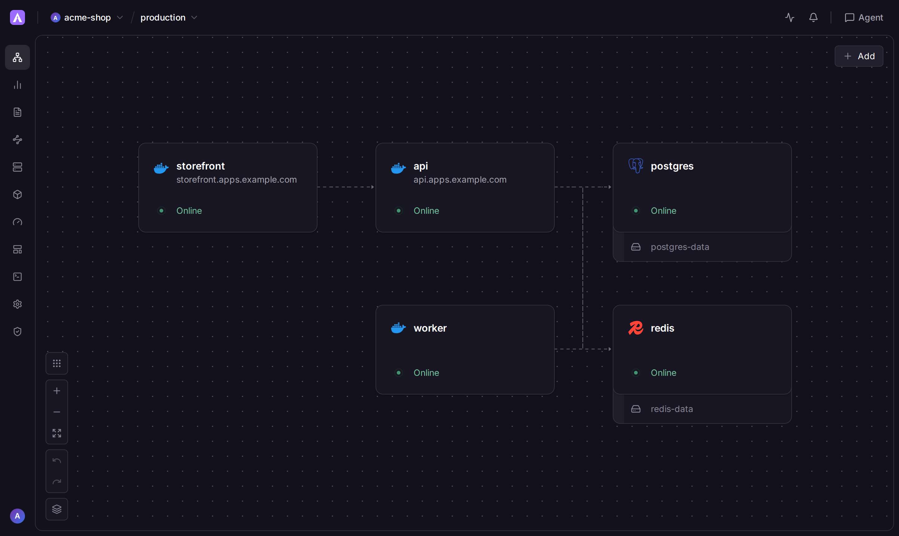
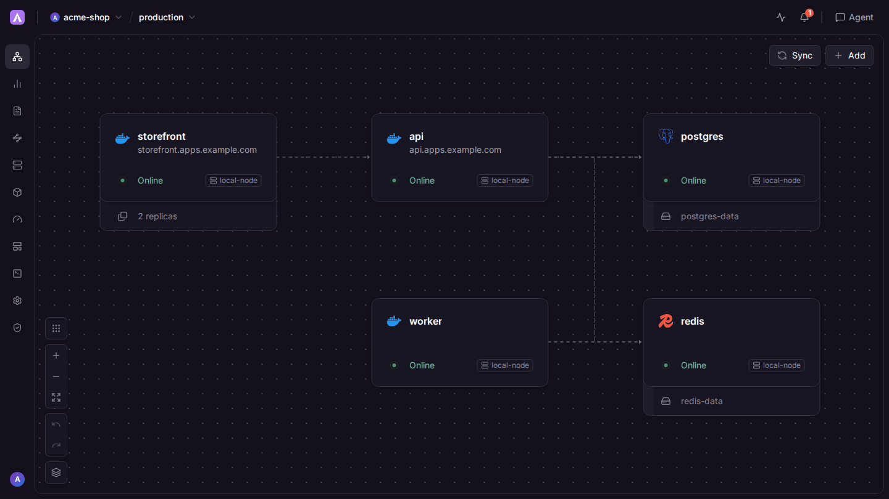
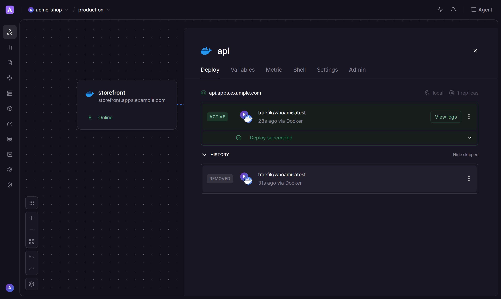
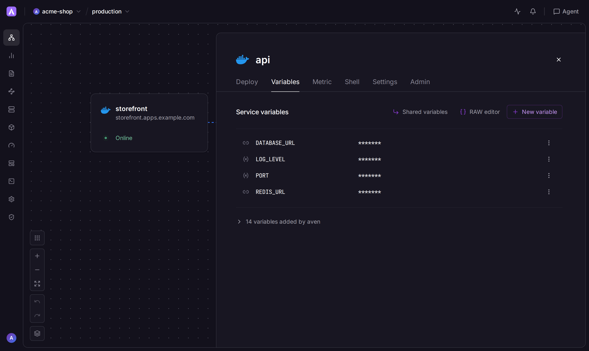
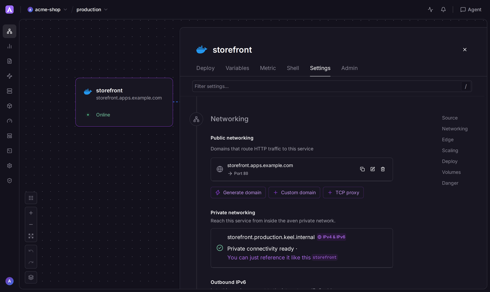
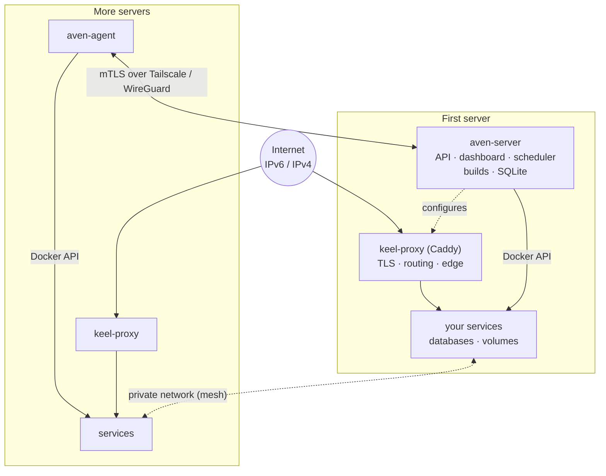

# Aven: a self-hosted, Railway-style PaaS

English | [한국어](README.ko.md)

**Use it like Railway, but on your own server, with no usage-based pricing.**

[](https://github.com/turin-dev/aven/releases)
[](https://github.com/turin-dev/aven/actions/workflows/ci.yml)
[](LICENSE)

[Quick start](#quick-start) · [Comparison](#comparison) · [Feature stability](#feature-stability) · [Highlights](#highlights) · [How it works](#how-it-works) · [Docs](#documentation) · [FAQ](#faq)

Railway, Coolify, and Dokploy are trademarks of their owners. Aven is not affiliated with them. Those names appear here only to describe what Aven is like and how it compares.

> [!IMPORTANT]
> Aven is an independent project and this repository contains no Railway source code. The canvas and service workflow follow Railway's, and Aven reads `railway.json` / `railway.toml` and answers Railway-shaped GraphQL queries so a project can move over. See [Relationship to Railway](#relationship-to-railway).

- Run it on your own servers. One `aven-server` process sits next to Docker; more machines join with `aven-agent`. There is no Kubernetes cluster to operate.
- The software in this repository has no usage fees and no paid feature tier. You pay for the machines you run.
- The license is [AGPL-3.0-only](LICENSE). SAML SSO and passkeys ship in that same core.
- The canvas, `railway.json`, and a Railway-shaped GraphQL API follow a Railway-style workflow.
- GitHub push deploys, pull-request preview environments, and one-click Postgres, MySQL, Redis, and MongoDB are included.





> [!NOTE]
> Aven is young and moves quickly. Interfaces and settings can change between releases, so read the release notes and back up the data directory before upgrading. The [stability labels](#feature-stability) below say what the tests in this tree cover. They are not a support commitment.

## Quick start

The install command below is the one in [`install-server.sh`](install-server.sh). Requirements and the rest of the first-run steps are in the [self-hosting guide](docs/self-hosting.md).

You need:

- a Linux server (amd64 or arm64) with systemd and Docker, ports 80 and 443 free;
- a DNS name for the dashboard (for example `aven.example.com`) and, for generated service domains, a wildcard (`*.apps.example.com`);
- optionally more servers for multi-node setups, reachable from each other over a private network such as Tailscale or WireGuard.

```sh
curl -fsSL https://raw.githubusercontent.com/turin-dev/aven/main/install-server.sh \
  | sudo sh -s -- --public-url https://aven.example.com
```

The script verifies the release checksum, installs `aven-server`, the CLI and Railpack, writes `/etc/keel/aven.env` with a generated admin password, starts the service and prints the sign-in details and the DNS records to create. Point `aven.example.com` (and, for generated service domains, `*.apps.example.com` with `KEEL_BASE_DOMAIN`) at the server, sign in, and follow the first-run checklist under *Admin → Owner · 초기 설정*.

Then open a project, press **Add** on the canvas and deploy your first service. The [self-hosting guide](docs/self-hosting.md) covers DNS, configuration, manual installation, backups, upgrades and adding servers.

## Screenshots

| Deployments | Variables | Networking |
| --- | --- | --- |
|  |  |  |

## Comparison

Aven cells come from this repository. Competitor cells come from the official pages linked under the table, checked on 2026-10-27. A cell is `?` when those pages did not state the fact. `?` is not a claim that the feature is missing.

| | aven | Railway | Coolify | Dokploy |
| --- | --- | --- | --- | --- |
| Self-hosted | Yes. `aven-server` on your Linux host; more hosts run `aven-agent`. [^aven] | Hosted plans from Free through Enterprise. A self-host installer: ? [^r-price] | Yes. Self-hosted is the free edition. [^c-price] | Yes. Self-Hosted (OSS). [^d-diff] |
| Pricing model | No usage fees and no paid-feature gate in this repository. You pay for your own machines. [^aven] | Per-second CPU, memory, and volume usage, plus a plan fee. The Free plan is $0 with $1 of usage credit per month. [^r-price] | Self-hosted is free and includes all current and upcoming features. Cloud is $5/month for two servers, then $3/month per extra server. [^c-price] | Self-Hosted (OSS) is free. Cloud starts at $4.50/month per server. Enterprise is a license (contact). [^d-diff] |
| License | AGPL-3.0-only. [^a-lic] | ? The pages checked do not state a license for the platform. The CLI docs say the CLI is open source. [^r-cli] | Apache-2.0. [^c-lic] | Apache-2.0, except a `/proprietary` directory if present, which `LICENSE.MD` places under a separate proprietary license. [^d-lic] |
| SSO in the free tier | Yes. SAML SSO is in the core. [^a-sso] | No on the Free plan. SSO is listed for Enterprise and for committed spend. [^r-price] | Yes on self-hosted (the free edition), from v4.3.0. Coolify Cloud manages its own sign-in. [^c-sso] | No. SSO is Enterprise only. The OSS and non-Enterprise Cloud editions do not include it. [^d-diff] |
| Passkeys | Yes. WebAuthn passkeys for dashboard sign-in. [^a-pk] | Yes, as account MFA. Whether every plan includes them: ? [^r-mfa] | ? [^c-pk] | Yes, for panel sign-in. Whether Cloud Hobby includes them: ? [^d-pk] |
| Multi-node | Yes. Additional servers join with `aven-agent`. [^a-nodes] | Horizontal replicas (plan limits) and geographic regions, on Railway's platform. Attaching your own servers: ? [^r-nodes] | Yes. Self-hosted can connect unlimited servers. [^c-price] | Yes. Multi-server / remote servers on the OSS edition. [^d-diff] |
| Preview environments | Yes. Pull-request environments. [^a-prev] | Yes. PR environments, created when a pull request opens and removed when it merges or closes. [^r-prev] | Yes. Pull-request and merge-request previews. [^c-prev] | Yes. GitHub pull-request previews, off by default. [^d-prev] |
| Managed databases | One-click Postgres, MySQL, Redis, MongoDB, and an S3-compatible bucket, on your servers. [^a-db] | Postgres, MySQL, Redis, and MongoDB templates. Railway provisions each one. HA is a conversion you turn on. [^r-db] | One-click Postgres, MySQL, MariaDB, MongoDB, Redis, Dragonfly, KeyDB, and ClickHouse, plus SQLite marked experimental, on your servers. [^c-db] | MySQL, PostgreSQL, MongoDB, Redis, and MariaDB, on your servers. [^d-feat] |
| PITR / backups | Postgres WAL and MySQL binlog PITR to backup storage, logical database backups, and a copy of aven's own SQLite database. [^a-pitr] | Volume backups, and PITR for Postgres and MySQL, which you turn on. [^r-pitr] | Scheduled dumps (Postgres uses `pg_dump` / `pg_dumpall`) with optional S3. The Postgres guide says PITR is continuous WAL archiving you set up separately. [^c-pitr] | Manual and scheduled database backups. PITR: ? [^d-feat] |
| Git push deploy | GitHub push webhooks. This tree has no git receive-pack server. [^a-git] | GitHub autodeploy when the connected branch is pushed. [^r-git] | Deploy on push through a GitHub App, GitLab, or a repository webhook. [^c-git] | GitHub autodeploy on push. Webhooks for GitHub, GitLab, Bitbucket, and Gitea. [^d-git] |
| Dockerfile / buildpack / Nixpacks | Dockerfile and Railpack. Unknown `railway.json` keys such as `nixpacksPlan` are ignored. A Dokploy nixpacks build is imported as Railpack. [^a-build] | Railpack and Dockerfile. Nixpacks and buildpacks: ? [^r-build] | Nixpacks, Dockerfile, Docker Compose, and static. Buildpacks: ? [^c-build] | Nixpacks (the default), Railpack, Dockerfile, Heroku buildpacks, Paketo buildpacks, and static. [^d-build] |
| Web UI | Yes. Embedded dashboard, English and Korean. [^aven] | Yes. Project canvas and service settings. [^r-ui] | Yes. Dashboard. [^c-price] | Yes. Dashboard. [^d-diff] |
| CLI | Yes. `aven`. [^a-cli] | Yes. Railway CLI, documented as open source. [^r-cli] | Yes. `coolify`. [^c-cli] | Yes. `@dokploy/cli`. [^d-cli] |

`?` in the table:

- Railway: a self-host installer; the platform source license; whether passkeys are on every plan; attaching your own servers; Nixpacks and buildpacks.
- Coolify: passkeys for the Coolify dashboard itself; buildpacks (Heroku, Paketo, or Cloud Native Buildpacks).
- Dokploy: database PITR; whether Cloud Hobby includes passkeys. The account-security page documents panel passkeys, and the Cloud plan table lists 2FA as unavailable on Hobby without mentioning passkeys.

[^aven]: This repository: [README.md](README.md), [docs/self-hosting.md](docs/self-hosting.md), [install-server.sh](install-server.sh). A search of the Go sources and docs found no billing, price, or license-key gate.
[^a-lic]: [LICENSE](LICENSE) and [THIRD_PARTY_NOTICES.md](THIRD_PARTY_NOTICES.md) (AGPL-3.0-only).
[^a-sso]: SAML routes in `internal/api/api.go`, [docs/permissions.md](docs/permissions.md), [docs/cli.md](docs/cli.md), tests in `internal/api/saml_test.go`.
[^a-pk]: `internal/api/auth.go`, `internal/api/mfa_test.go`, `internal/store/mfa_test.go`.
[^a-nodes]: [docs/self-hosting.md](docs/self-hosting.md) (“Adding servers”), `internal/store/nodes_test.go`, `internal/deploy/mesh_test.go`.
[^a-prev]: `internal/api/github_preview_test.go`, `internal/store/preview_test.go`.
[^a-db]: `internal/catalog/catalog.go` (Postgres, MySQL, Redis, MongoDB) and the bucket service in [docs/cli.md](docs/cli.md).
[^a-pitr]: `aven pitr` in [docs/cli.md](docs/cli.md) (Postgres WAL, MySQL binlog), `internal/api/dbpitr_test.go`, `internal/agent/dbbackup_test.go`, and the server database backup in [docs/self-hosting.md](docs/self-hosting.md).
[^a-git]: GitHub webhook setup in [docs/self-hosting.md](docs/self-hosting.md). No git receive-pack server showed up in the Go tree.
[^a-build]: [docs/self-hosting.md](docs/self-hosting.md), `internal/config/config.go` (unknown keys including `nixpacksPlan` are ignored), `internal/dokploy/translate.go` (a nixpacks build is replaced by Railpack).
[^a-cli]: [docs/cli.md](docs/cli.md), `cmd/aven`.

[^r-price]: [railway.com/pricing](https://railway.com/pricing) and [railway.com/enterprise](https://railway.com/enterprise), fetched 2026-10-27. The pricing page lists Free through Enterprise, per-second usage rates, and SSO under Enterprise and committed spend.
[^r-cli]: [docs.railway.com/cli](https://docs.railway.com/cli) (“The Railway CLI is open source”), fetched 2026-10-27.
[^r-mfa]: [docs.railway.com/access/multi-factor-authentication](https://docs.railway.com/access/multi-factor-authentication), fetched 2026-10-27. The page documents passkeys and does not name a plan.
[^r-nodes]: Replica limits on [railway.com/pricing](https://railway.com/pricing). Regions are listed on [docs.railway.com/deployments](https://docs.railway.com/deployments) (“Deploy to specific geographic regions”). Neither page describes attaching your own server.
[^r-prev]: [docs.railway.com/guides/preview-deployments-with-pr-environments](https://docs.railway.com/guides/preview-deployments-with-pr-environments), fetched 2026-10-27.
[^r-db]: [Postgres](https://docs.railway.com/databases/postgresql), [MySQL](https://docs.railway.com/databases/mysql), [Redis](https://docs.railway.com/databases/redis), and [MongoDB](https://docs.railway.com/databases/mongodb), fetched 2026-10-27.
[^r-pitr]: [docs.railway.com/volumes/point-in-time-recovery](https://docs.railway.com/volumes/point-in-time-recovery) (Postgres and MySQL) and the backup sections of the Postgres and MySQL pages above, fetched 2026-10-27.
[^r-git]: [docs.railway.com/deployments/github-autodeploys](https://docs.railway.com/deployments/github-autodeploys), fetched 2026-10-27.
[^r-build]: [docs.railway.com/builds](https://docs.railway.com/builds), fetched 2026-10-27. The page documents Railpack and Dockerfiles. It does not mention Nixpacks or buildpacks.
[^r-ui]: Project canvas on the Postgres page and service settings on the autodeploy page, same fetches as above.

[^c-price]: [coolify.io/pricing](https://coolify.io/pricing), fetched 2026-10-27. Self-hosted is “Free forever” with “Full access to all features” and unlimited connected servers. Cloud is “$5 /month base price (connect 2 servers)” plus “$3 /month per additional server”.
[^c-lic]: [github.com/coollabsio/coolify `LICENSE`](https://github.com/coollabsio/coolify/blob/main/LICENSE) (Apache License 2.0), fetched 2026-10-27.
[^c-sso]: [coolify.io/docs/core/security/authentication/sso/overview](https://coolify.io/docs/core/security/authentication/sso/overview), fetched 2026-10-27. SSO is for self-hosted Coolify (v4.3.0+). The page says Coolify Cloud manages its own authentication.
[^c-pk]: Searched Coolify’s docs on 2026-10-27. Dashboard docs describe two-factor authentication ([disable 2FA manually](https://coolify.io/docs/troubleshoot/dashboard/disable-2fa-manually)) and SSO. [Pocket ID](https://coolify.io/docs/services/pocket-id) is a separate app you can deploy. No page was found that adds passkeys to Coolify’s own sign-in.
[^c-db]: [coolify.io/docs/databases](https://coolify.io/docs/databases), fetched 2026-10-27. The page lists the engines above and marks SQLite experimental.
[^c-pitr]: [coolify.io/self-host-postgres-with-backups](https://coolify.io/self-host-postgres-with-backups), fetched 2026-10-27. Scheduled backups are `pg_dump` / `pg_dumpall`. The page’s PITR question says that is a separate WAL-archiving setup.
[^c-prev]: [coolify.io/docs/applications/deployments/preview-deployments](https://coolify.io/docs/applications/deployments/preview-deployments), fetched 2026-10-27.
[^c-git]: [Automatic deployments](https://coolify.io/docs/applications/deployments/automatic-deployments), fetched 2026-10-27. Deploy on push is documented for a GitHub App, GitLab, and a repository webhook.
[^c-build]: [Deploy with Nixpacks](https://coolify.io/docs/applications/builds/nixpacks/deploy) and the `coolify` CLI `--build-pack` values `nixpacks`, `static`, `dockerfile`, `dockercompose` on [create deploy key](https://coolify.io/docs/cli/command-reference/commands/app/create-deploy-key), fetched 2026-10-27. Those pages do not list a buildpack builder.
[^c-cli]: [coolify app create deploy-key](https://coolify.io/docs/cli/command-reference/commands/app/create-deploy-key), fetched 2026-10-27.

[^d-diff]: [docs.dokploy.com/docs/core/differences](https://docs.dokploy.com/docs/core/differences), fetched 2026-10-27. Self-Hosted (OSS) is free and includes multi-server. SSO is marked off for OSS and for non-Enterprise Cloud, and on for Enterprise.
[^d-lic]: [github.com/Dokploy/dokploy `LICENSE.MD`](https://github.com/Dokploy/dokploy/blob/canary/LICENSE.MD) on the default branch (`canary`), fetched 2026-10-27.
[^d-pk]: [docs.dokploy.com/docs/core/account-security](https://docs.dokploy.com/docs/core/account-security), fetched 2026-10-27. The Cloud plan table on the differences page lists 2FA as unavailable on Hobby and does not mention passkeys.
[^d-prev]: [docs.dokploy.com/docs/core/applications/preview-deployments](https://docs.dokploy.com/docs/core/applications/preview-deployments), fetched 2026-10-27.
[^d-feat]: [docs.dokploy.com/docs/core/features](https://docs.dokploy.com/docs/core/features) (MySQL, PostgreSQL, MongoDB, Redis, MariaDB; manual and scheduled backups), fetched 2026-10-27. A search of the published docs corpus found no Dokploy PITR page. A template such as Databasus that mentions PITR is a separate app, not Dokploy’s database backups.
[^d-git]: [docs.dokploy.com/docs/core/auto-deploy](https://docs.dokploy.com/docs/core/auto-deploy), fetched 2026-10-27.
[^d-build]: [docs.dokploy.com/docs/core/applications/build-type](https://docs.dokploy.com/docs/core/applications/build-type), fetched 2026-10-27.
[^d-cli]: [docs.dokploy.com/docs/cli](https://docs.dokploy.com/docs/cli) (`npm install -g @dokploy/cli`), fetched 2026-10-27.

## Feature stability

**Stable** means the feature is described for operators in this repository and has dedicated tests here. **Experimental** means that bar was not met. The reason is in the last column. Either label can change, and a Stable feature can still move between releases.

| Feature | Label | Why |
| --- | --- | --- |
| Single-server install (`aven-server`, Docker, Caddy proxy) | Stable | [`install-server.sh`](install-server.sh), [docs/self-hosting.md](docs/self-hosting.md), `internal/selfhost/*_test.go` |
| Extra servers (`aven-agent`) and the private mesh | Stable | Self-hosting guide, “Adding servers”; `internal/agent/*_test.go`, `internal/deploy/mesh_test.go` |
| GitHub push-to-deploy and pull-request previews | Stable | `internal/api/github_preview_test.go`, `internal/watch/watch_test.go` |
| Dockerfile and Railpack builds | Stable | `internal/node/railpack_test.go`, `internal/config/config_test.go` |
| Image services, Compose, templates, functions, `aven up` | Stable | `internal/compose/compose_test.go`, `internal/api/templates_test.go`, `internal/api/functions_test.go`, `internal/agent/extra_test.go` (`TestSourceUploadExtractsSafely`) |
| Environments, variable references, sealed variables, config as code | Stable | `internal/vars/vars_test.go`, `internal/api/sealed_test.go`, `internal/config/config_test.go` |
| One-click Postgres, MySQL, Redis, MongoDB, and S3-compatible buckets | Stable | `internal/catalog/catalog.go` and its tests, `internal/api/bucket_test.go` |
| Data browser | Stable | `internal/api/dbdata_test.go`, `internal/api/dbdata_edit_test.go` |
| Logical backups and PITR (Postgres WAL, MySQL binlog) | Stable | [docs/cli.md](docs/cli.md) `aven pitr`; `internal/agent/dbbackup_test.go`, `internal/api/dbpitr_test.go` |
| PgBouncer, Postgres major upgrades, database HA | Stable | `internal/api/postgres_test.go`, `internal/catalog/ha_test.go`, `cmd/aven/ha_test.go` |
| Domains, automatic TLS, path rules, redirects, basic auth, wildcards | Stable | `internal/proxy/caddy_test.go` (`TestPathRulesOrdering`, `TestRedirectAndAuthAndTrust`, `TestBuildWildcardAutoTLS`) |
| Per-domain IPv6 and TCP proxies | Stable | `internal/deploy/ipv6addr_test.go`, `internal/deploy/ports_test.go` |
| Private DNS between services | Stable | `internal/deploy/privatedns_test.go` |
| Edge cache and WAF rules | Stable | `internal/api/edge_test.go`, `internal/proxy/edge_test.go` |
| Cloudflare Tunnel ingress | Experimental | The ingress mode is stored and validated in `internal/api/domainstate_test.go`. No test starts a tunnel. |
| Replicas, autoscaling, rollbacks, deploy overlap | Stable | `internal/deploy/scale_test.go`, overlap settings in `internal/api/batch2_test.go` |
| Moving a volume onto another node | Stable | `internal/deploy/remote_test.go` (`TestCopyVolumesCopiesDataAndReportsOldLocation`) |
| App sleeping (wake on the next request) | Experimental | Implemented in `internal/deploy/sleep.go`. Config parsing is tested. No test covers the idle-sleep and wake path. |
| Cron schedules | Experimental | Expressions are parsed and stored (`internal/cronx/cron_test.go`, API tests). No test was found that fires a scheduled run. |
| Image auto-updates | Stable | `internal/deploy/imageupdates_test.go` |
| Logs, metrics, tracing, alerts | Stable | `internal/tracing/tracing_test.go`, `internal/alerts/alerts_test.go`, `internal/metrics/` |
| Workspaces, roles, access groups, audit log | Stable | [docs/permissions.md](docs/permissions.md), `internal/store/permissions_test.go`, `internal/api/access_controls_test.go` |
| Passkeys, TOTP, enforced 2FA | Stable | `internal/api/mfa_test.go`, `internal/store/mfa_test.go` |
| SAML SSO | Stable | `internal/api/saml_test.go` |
| OAuth 2.0 / OpenID Connect provider | Stable | [docs/api-v1.md](docs/api-v1.md), `internal/store/oauth_test.go`, `internal/api/oauth_test.go` |
| CLI, HTTP API, GraphQL, MCP | Stable | [docs/cli.md](docs/cli.md), [docs/api-v1.md](docs/api-v1.md), `internal/api/graphql_test.go`, `cmd/aven/mcp_test.go` |
| Infrastructure as code | Stable | `internal/deploy/configapply_test.go`, `internal/iac/` |
| Feature flags | Stable | `internal/api/featureflags_test.go`, `sdk/index.test.ts` |
| Sandboxes | Stable | `internal/api/sandboxes_test.go` |
| Dokploy import | Stable | `cmd/aven/importdokploy_test.go` |
| Aven on Aven (self-upgrade) | Stable | [docs/selfhost.md](docs/selfhost.md), `internal/deploy/selfhost_test.go`, `internal/api/selfservice_test.go` |
| AI assistant (bring your own model) | Experimental | Settings and tool calls are documented in [docs/api-v1.md](docs/api-v1.md). That page lists limits, including logs sent to the model without redaction, and no service creation. |
| Web dashboard | Experimental | English and Korean UI sources and the screenshots above are in the tree. `web/` has no automated component or end-to-end tests. |

<!-- DRAFT: owner to review -->

## How this was built

This section is a draft for the maintainer to edit. It only uses what this repository shows, plus one account the maintainer asked to include. Replace anything that is wrong.

**What the git history shows.** `git log` on this repository has five commits. The first, `755a737` (2026-10-25), is titled “Aven: a self-hosted platform for deploying and running applications on your own servers” and its body says “Initial public release of the source tree.” The other commits, on 2026-10-25 and 2026-10-26, adjust the README, bump a SAML dependency, and email workspace owners when a suspension or deploy block changes. There is no `CHANGELOG` file. No commit message in this history mentions Keel.

**Keel, from names that are still in the tree.** The docs say Aven continues a project named Keel and keeps its runtime names so an existing install upgrades in place. See [Upgrading from Keel](#upgrading-from-keel) and the note at the top of [docs/self-hosting.md](docs/self-hosting.md). The names still in the tree:

- Environment variables are `KEEL_*` (`KEEL_DATA`, `KEEL_PUBLIC_URL`, `KEEL_ADMIN_PASSWORD`, and the others listed in the self-hosting guide).
- State lives in `/var/lib/keel`. The installer writes `/etc/keel/aven.env` ([`install-server.sh`](install-server.sh)).
- The proxy container is `keel-proxy`. The upgrade section below also names `/var/lib/keel-agent`, the `keel-agent` unit, `.keel` CLI links, and `keel.*` container labels.
- Config-as-code reads `keel.json` and `keel.toml` next to `aven.json` and `railway.json` (`internal/config/config.go`).
- The one-click database templates default the database name to `keel` (`internal/catalog/catalog.go`).

<!-- TODO(owner): when Keel started, whether a public Keel repository existed, why the name became Aven, and a link to that history if it should be published. This git history does not contain it. -->

**How it was written.** AI coding agents were used substantially in development. Changes went through human review and testing.

<!-- TODO(owner): name the agents and the period they were used, what they were allowed to change, and who reviewed. Say what was tested by hand and on which kind of server. The repository does not record those details. -->

<!-- TODO(owner): if the sentence above overstates the review process, replace it. It is the maintainer's account for this draft. No commit message in this repository spells it out. -->

## Highlights

**Deploy**
- Services from GitHub repositories (Dockerfile or [Railpack](https://github.com/railwayapp/railpack), no Dockerfile needed), Docker images, Docker Compose files, templates, single-file functions or a local directory (`aven up`).
- Push-to-deploy with watch paths, wait-for-CI, commit statuses and pull request preview environments.
- Environments with variable references (`${{ db.DATABASE_URL }}`), shared and sealed variables, a raw editor and config as code (`railway.json`, `keel.json`).
- Pre-deploy commands, health checks, zero-downtime overlap, rollbacks, cron jobs, app sleeping and image auto-updates.

**Data**
- One-click PostgreSQL, MySQL, Redis, MongoDB and S3-compatible buckets, with volumes, a data browser and logical backups to S3.
- Point-in-time recovery, PgBouncer pooling, major version upgrades and high-availability clusters for PostgreSQL.

**Networking**
- Generated and custom domains with automatic TLS through a managed Caddy proxy, path rules, redirects, basic auth and wildcard domains.
- IPv6 first: optional per-domain public IPv6 addresses, outbound IPv6 control and TCP proxies for databases and other raw TCP services.
- Private DNS names between services, also across servers over an encrypted mesh (Tailscale or WireGuard addresses).
- Edge caching, WAF rules and Cloudflare Tunnel ingress.

**Multiple servers**
- Add servers with a one-line agent install. Place services on a node, spread replicas across nodes, autoscale on CPU, memory or requests per second, and move services with their volumes.

**Observability**
- Build, deploy and runtime logs, HTTP and network flow logs, metrics, OpenTelemetry tracing, dashboards, metric alerts and notifications (webhooks, Slack, Discord, email).

**Teams and security**
- Workspaces, projects and environments with roles, access groups, restricted environments and guardrails for allowed sources.
- Passkeys, TOTP, enforced 2FA, SAML SSO, an OAuth 2.0 / OpenID Connect provider ("Login with Aven"), API tokens, audit logs, usage and resource limits.

**Automation**
- `aven` CLI, REST and GraphQL APIs, an MCP server for AI tools, an optional AI assistant (bring your own model), infrastructure as code for whole projects, sandboxes and a feature flags SDK.
- `aven import dokploy` moves an existing Dokploy installation.

**Aven on Aven**
- The server manages itself: `aven-server` appears on the server owner's canvas, checks its repository for updates and upgrades itself from a deployment, with an automatic rollback if the new version is not healthy. Server settings are edited from the same panel. See [Aven on Aven](docs/selfhost.md).

## How it works



- `aven-server` is a single Go binary with the dashboard embedded. It keeps its state in SQLite (`/var/lib/keel`), builds images with Docker and Railpack, and runs containers through the Docker API.
- `keel-proxy` is a Caddy container that Aven configures. It terminates TLS, routes domains to replicas on its own node and serves the edge features.
- `aven-agent` runs on additional servers, connects back to the server with a certificate and runs the same Docker operations there. Services on different nodes reach each other through an mTLS mesh on the private addresses you provide.

## Build from source

Requirements: Go 1.26+, Node.js 20.9+ with npm, and Docker for running the server.

```sh
make all        # web UI, aven-server, agents and CLI binaries in ./bin
```

Run a local instance for evaluation:

```sh
mkdir -p ./data
KEEL_ADMIN_PASSWORD='replace-with-a-long-password' \
KEEL_HTTP_PORT=18080 KEEL_HTTPS_PORT=18443 KEEL_PROXY_BIND=127.0.0.1 \
./bin/aven-server -listen 127.0.0.1:7070 -data ./data
```

Sign in at `http://127.0.0.1:7070` as `admin@local`. The server starts its proxy container through Docker; change the ports and bind address before running it on a network. For production, use [`deploy/aven.env.example`](deploy/aven.env.example) and [`deploy/aven-server.service`](deploy/aven-server.service), or `docker build -t aven-server .` for the container image.

## Upgrading from Keel

Aven is the continuation of Keel and keeps its runtime names, so existing installations upgrade in place: `KEEL_*` settings, `/var/lib/keel`, `/var/lib/keel-agent`, the `keel-agent` unit, `.keel` CLI links and `keel.*` container labels all stay. Copy the environment file to `/etc/keel/aven.env`, install `deploy/aven-server.service` and the `aven-server` binary, stop `keel-server` and enable `aven-server`. Never run both against the same data directory.

## Relationship to Railway

Aven is an independent implementation. This repository contains none of Railway's source code: the server, agents, CLI, proxy configuration and dashboard were written for Aven.

What Aven shares with Railway is on the surface:

- **Look and workflow.** The canvas, service panel and settings follow Railway's dashboard, because many people already know that workflow.
- **Compatibility.** Aven accepts `railway.json` / `railway.toml` config files and offers a GraphQL endpoint shaped like Railway's public API, so existing configuration and scripts keep working when you move.
- **Railpack.** Builds without a Dockerfile use [Railpack](https://github.com/railwayapp/railpack), an open-source builder published by Railway (MIT, [license](https://github.com/railwayapp/railpack/blob/main/LICENSE)), run as a separate program.

Railway is a trademark of its owner and is used here only to describe compatibility. The [comparison](#comparison) records what the Railway docs say, and leaves the platform license as `?` because the pages checked did not state it.

## Documentation

- [Self-hosting guide](docs/self-hosting.md): install, DNS, configuration, backups, upgrades, nodes
- [Aven on Aven](docs/selfhost.md): let Aven manage and upgrade its own server
- [CLI reference](docs/cli.md)
- [HTTP API](docs/api-v1.md) and [GraphQL API](docs/graphql.md)
- [Permissions and workspaces](docs/permissions.md)
- [Feature flags SDK](sdk/README.md)

## FAQ

**Does it need Kubernetes?** No. Aven runs containers with plain Docker on each server and keeps its own state in SQLite. There is no cluster to install or operate.

**Is it production-ready?** It runs real workloads for its authors, but it is young: expect rough edges and read the release notes before upgrading. Back up the data directory (`/var/lib/keel`), which holds the database and the key that encrypts secrets. See [Feature stability](#feature-stability) for what the tests in this tree cover.

**Do I need GitHub?** No. You can deploy Docker images, Compose files, templates and local directories (`aven up`). GitHub is needed for push-to-deploy and preview environments.

**How do I upgrade?** Run the install script again, or let Aven upgrade itself from its own canvas ([Aven on Aven](docs/selfhost.md)). Database migrations run on start.

**Can I move from Railway or Dokploy?** Aven reads `railway.json` / `railway.toml` and answers Railway-shaped GraphQL queries, and `aven import dokploy` recreates a Dokploy installation's services, variables, domains and volumes. Data is not copied: move database contents with your usual dump and restore tools.

**Why AGPL?** So that improvements to a hosted Aven stay open. Running Aven for your own apps, at any scale, has no extra obligations; offering a modified Aven to others over a network means sharing those modifications.

## Contributing

Bug reports, documentation fixes and pull requests are welcome. Read [CONTRIBUTING.md](CONTRIBUTING.md) and the [code of conduct](CODE_OF_CONDUCT.md) first. Report security vulnerabilities privately as described in [SECURITY.md](SECURITY.md).

## License

Aven is licensed under the [GNU Affero General Public License v3.0 only](LICENSE) (AGPL-3.0-only). If you run a modified version for others over a network, you must offer them its source. Bundled third-party software and fonts are listed in [THIRD_PARTY_NOTICES.md](THIRD_PARTY_NOTICES.md).
